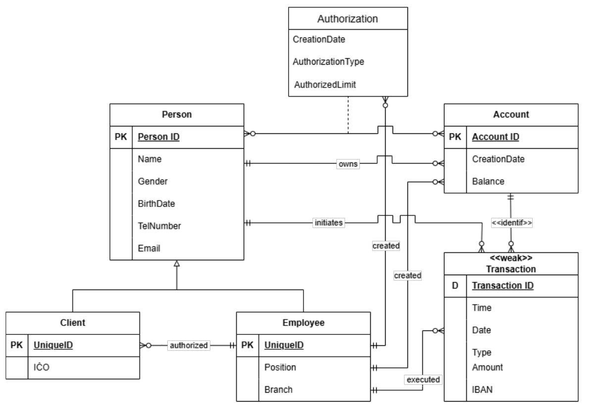

# Bank database (IDS)

An Oracle database project modelling a **bank** — clients, employees, accounts, account
ownership, authorizations and transactions. Built for the IDS course (Database Systems) at BUT FIT.

> **Authors:** Andrej Guláš ([@M3rimen](https://github.com/M3rimen), xgulasa00) · Samuel Fačka
> ([@faco1228](https://github.com/faco1228), xfackas00) — two-person team project · Oracle 12c · SQL / PL/SQL

The project was developed in four incremental parts:

| Part | Folder | What it adds |
|------|--------|--------------|
| 1 | [`1-data-model/`](1-data-model/) | Conceptual model — ER diagram and use case diagram (`data-model.pdf`, in Slovak) |
| 2 | [`2-schema/`](2-schema/) | Schema — 7 tables with a generalization/specialization hierarchy, keys, constraints and sequences |
| 3 | [`3-queries/`](3-queries/) | Schema + `SELECT` queries — joins, grouping with aggregation, `EXISTS` subqueries |
| 4 | [`4-advanced/`](4-advanced/) | Advanced objects — triggers, stored procedures, an index evaluated with `EXPLAIN PLAN`, a materialized view and access rights |



Each SQL script is **idempotent**: it drops any existing objects first, then recreates them, so it
can be run repeatedly.

## Highlights (part 4)

- **Triggers** — automatic ID generation from sequences, rejecting a withdrawal that would
  overdraw an account, and logging client status changes to an audit table
- **Stored procedures** — transferring money between accounts and generating a client report
- **Materialized view** summarising client/account data
- **Index** on transactions, with the query plan compared via `EXPLAIN PLAN`
- **Access rights** for the second team member via `GRANT`

## Running

In an Oracle environment (e.g. SQL*Plus), run the part you want:

```sql
@4-advanced/advanced.sql
```

Running part 4 sets up the full advanced schema from scratch.

## Note

A two-person team project; the author headers are kept in each script. Comments inside the SQL
scripts are in Slovak.
